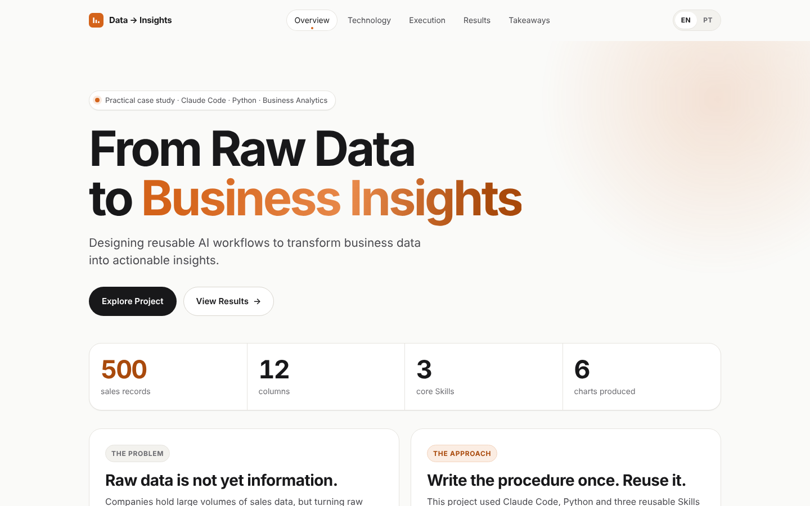
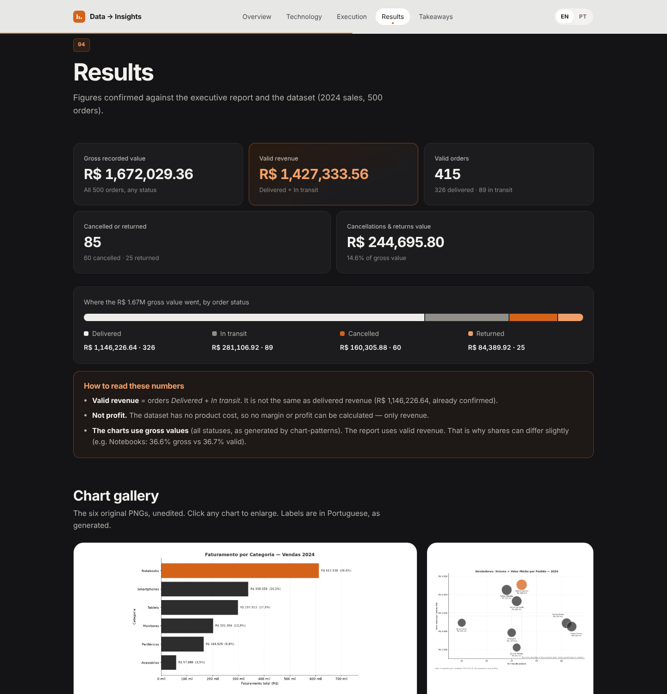
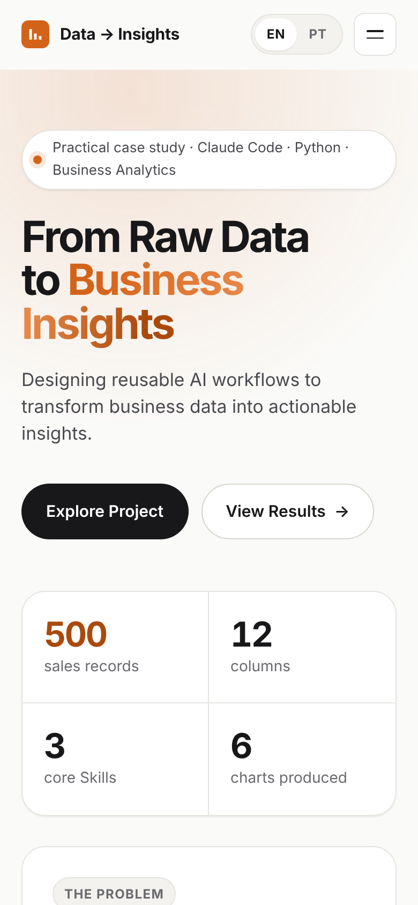
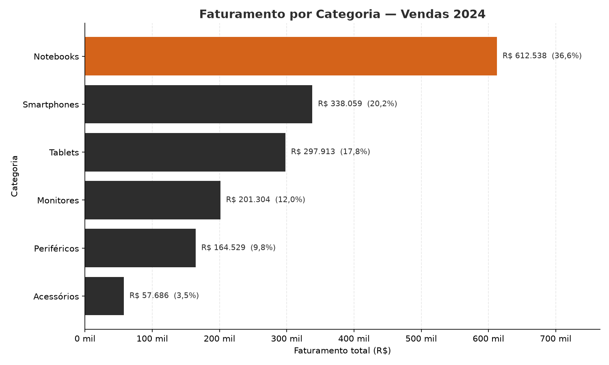
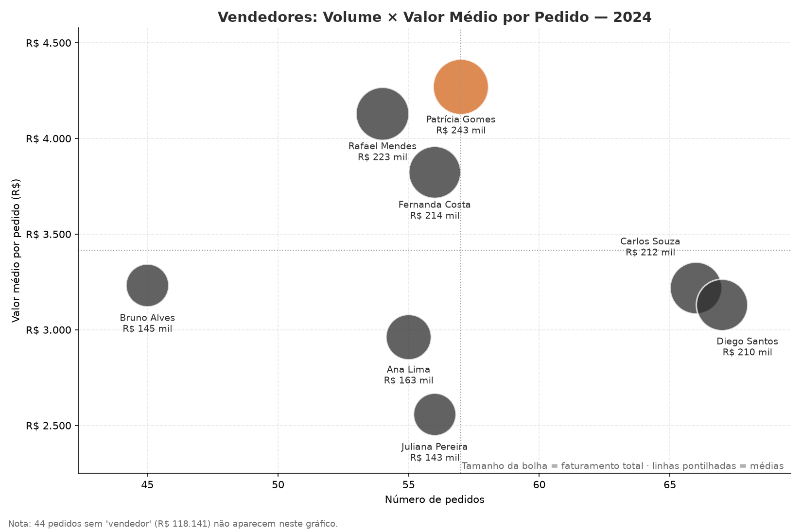
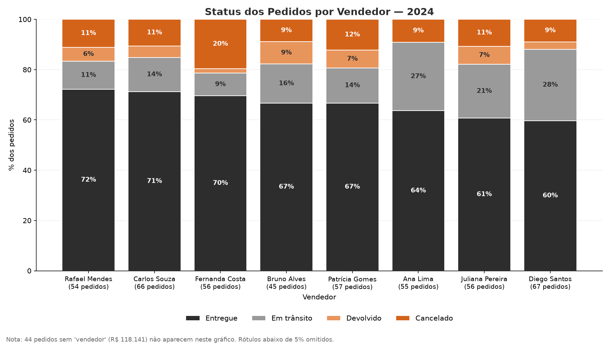
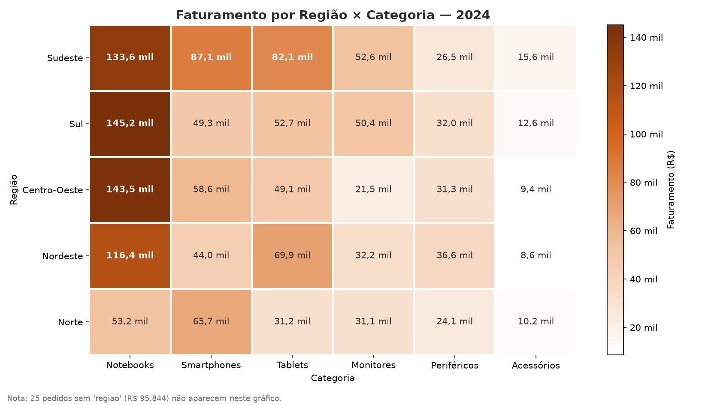
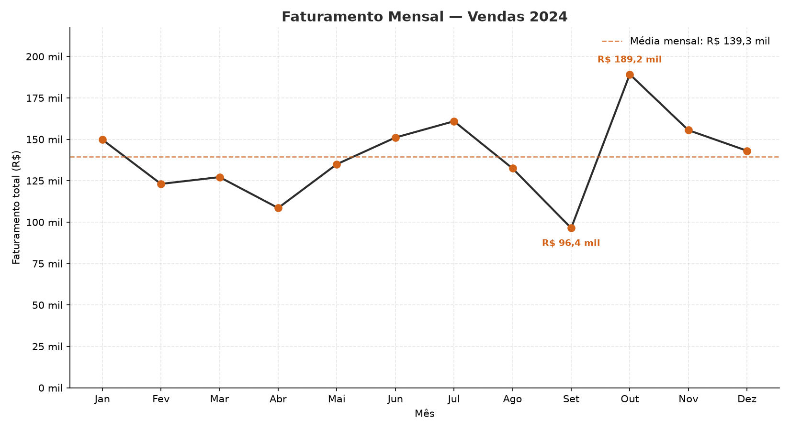
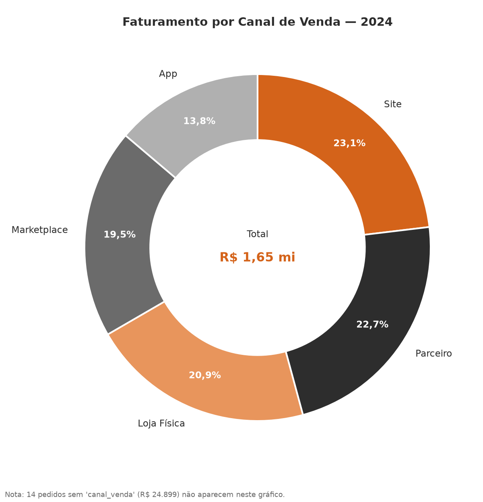

# Claude Code Skills — From Data to Business Insights

> A practical case study exploring how reusable AI workflows, Claude Code and Python can transform business data into structured insights.


---

## Live Demo

### 🔗 [Live Demo — View Interactive Website](https://brumo97.github.io/claude-skills-business-analytics/)

Hosted on GitHub Pages: **https://brumo97.github.io/claude-skills-business-analytics/** — no installation needed.

The site is bilingual — **English / Português (Brasil)** — with a language switch in the header.

---

## Project Overview

Companies hold large volumes of sales data, but turning raw records into reliable analysis requires the same careful steps every time: validate the data, process it, visualize it and explain it.

This project explores a simple idea: **write those procedures once, as reusable instructions, and let an AI coding environment apply them consistently.**

Using **Claude Code**, **Python** and **three reusable Skills**, I analyzed a year of retail sales (2024, 500 orders, 12 columns), produced **six standardized charts** and an **executive report** — and built this website to present the process and the results.

| | |
|---|---|
| Sales records | **500** |
| Columns | **12** |
| Core Skills | **3** (+ 2 experimental) |
| Charts produced | **6** |

---

## Project Screenshots

#### Desktop Preview



#### Analytics & Results



#### Responsive Mobile View

<p align="center">
  
</p>

*Real screenshots of the final website, captured in a Chromium browser (desktop: 1440 px wide; mobile: 390 px wide).*

---

## Technologies

| Layer | Tool | Role |
|---|---|---|
| Website | HTML5, CSS3, Vanilla JavaScript | Static single-page site — no framework, no build step, no dependencies |
| AI environment | Claude Code | Reads the project rules, runs the Skills and executes Python |
| Procedures | Claude Skills (`SKILL.md`) | Reusable instructions that standardize profiling, charting and reporting |
| Analysis | Python + pandas | Data profiling, quality checks and aggregations |
| Visualization | matplotlib | Chart library specified in the `chart-patterns` protocol (seaborn is listed as available in the Skills) |
| Data | CSV | Source dataset (read-only) |
| Documentation | Markdown | Project rules, Skills and the executive report |

> Python was run **inline** (via stdin) on purpose: the project rules forbid leaving script files behind, so the repository contains no `.py` files.

---

## Project Workflow

```
Dataset  →  Data Analysis  →  Reusable Skills  →  Charts  →  Executive Report
 (CSV)       (pandas)          (SKILL.md)          (6 PNG)     (Markdown)
```

1. **Data Preparation** — structure and quality checks. Fixes applied to the reference file: the “Acessórios” category standardized, 7 discounts recalculated, 3 order totals corrected.
2. **Reusable Skills** — three Skills written to standardize the work.
3. **Data Analysis** — orders explored by category, product, region, seller, channel, status and month.
4. **Data Visualization** — six charts with one visual standard (orange `#D4631A` + dark gray, 150 dpi).
5. **Executive Reporting** — conclusion first, evidence second, every figure tied to a source.

Skills are **instructions, not autonomous agents**: Claude Code follows them when a task matches their description.

---

## Skills Architecture

### Core Skills — `.claude/skills/`

| Skill | Purpose | Key rules |
|---|---|---|
| [`data-profile-conventions`](.claude/skills/data-profile-conventions/SKILL.md) | Profiles the quality of any CSV: shape, types, nulls, IQR outliers, category spelling, duplicates, invalid dates, derived-column formulas | Never modifies the source · reports facts only, no business recommendations |
| [`chart-patterns`](.claude/skills/chart-patterns/SKILL.md) | Generates standardized charts with Python/matplotlib, choosing the chart type from the question | Fixed palette and style · PNG ≥ 150 dpi · predictable file names · never `plt.show()` |
| [`report-style`](.claude/skills/report-style/SKILL.md) | Turns analysis into an executive report for decision-makers | Conclusion first · concrete numbers · cite every source · never invent data |

Project-wide rules live in [`.claude/CLAUDE.md`](.claude/CLAUDE.md) (protected files, allowed outputs, language).

### Experimental Skills — `Conceitos/skill-experimento-1/`

Two early Skills used to test the format before the core set:

- [`resumir-texto`](Conceitos/skill-experimento-1/.claude/skills/resumir-texto/SKILL.md) — summarizes any text into 3 objective bullets.
- [`resumo-5`](Conceitos/skill-experimento-1/.claude/skills/resumo-5/SKILL.md) — summarizes a text or file in exactly 5 lines.

---

## Results

### Key figures (2024)

| Indicator | Value |
|---|---|
| Gross recorded value (all 500 orders) | R$ 1,672,029.36 |
| **Valid revenue** (Delivered + In transit) | **R$ 1,427,333.56** |
| Valid orders | 415 (326 delivered · 89 in transit) |
| Cancelled or returned | 85 (60 cancelled · 25 returned) |
| Value of cancellations & returns | R$ 244,695.80 (14.6% of gross) |

**How to read these numbers**

- *Valid revenue* includes orders still **in transit** (R$ 281,106.92). Confirmed delivered revenue is R$ 1,146,226.64.
- This is **revenue, not profit**: the dataset has no product cost, so no margin can be calculated.
- The **charts use gross values** (all statuses); the report uses valid revenue — shares can differ slightly.

### Main findings

- **Notebooks drive revenue:** 36.7% of valid revenue (R$ 524,081.90). One product, the Notebook Gamer X, accounts for 17.7% alone.
- **Channels perform differently:** Partner and Website lead with 46.1% of valid revenue; the App has the lowest revenue and loses 24.1% of its orders to cancellations or returns.
- **Losses:** R$ 244,695.80 (14.6% of gross value) in cancelled and returned orders.
- **Unattributed orders:** 44 records (8.8%) have no seller — R$ 89,312.20 of valid revenue that can't be assigned, with the highest loss rate (27.3%).
- **Accessories:** 28.9% of valid orders but only 3.5% of valid revenue.
- **Limitations:** no cost data, no targets, a single year, no cancellation reasons, no customer data.

### Charts

| | |
|---|---|
|  |  |
|  |  |
|  |  |

Full report (Portuguese): [`output/relatorio-executivo-2026-11-15.md`](output/relatorio-executivo-2026-11-15.md)

---

## Repository Structure

```
.
├── index.html                  # Single-page website (EN / PT-BR)
├── style.css                   # Styles — mobile first, no framework
├── script.js                   # i18n, navigation, animations, chart modal
├── README.md
│
├── assets/
│   └── screenshots/            # Real screenshots used in this README
│
├── .claude/
│   ├── CLAUDE.md               # Project rules
│   └── skills/
│       ├── data-profile-conventions/SKILL.md
│       ├── chart-patterns/SKILL.md
│       └── report-style/SKILL.md
│
├── Conceitos/
│   └── skill-experimento-1/    # Experimental Skills
│
├── Projeto-bruno-store/
│   └── Dataset/                # Source CSV (500 orders, 2024)
│
└── output/
    ├── charts/                 # 6 PNG charts
    └── relatorio-executivo-2026-11-15.md
```

---

## Key Takeaways

- **Reusable workflows** — repetitive procedures deserve written, standardized instructions.
- **Data quality first** — validate before concluding; profiling surfaced fixes and blank fields that would have distorted rankings.
- **Consistency over speed** — same checks, same chart style, same report structure every time.
- **Data storytelling** — six charts and one report turn 500 rows into something a manager can read in minutes.
- **Decision support** — indicators point to concrete questions: product dependence, App losses, unattributed orders, revenue still in transit.
- **Technical organization** — clear separation of rules, Skills, source data and outputs, with protected files that are never modified.

> *“The real value of AI isn't just generating outputs. It's building reliable workflows that transform information into better decisions.”*
